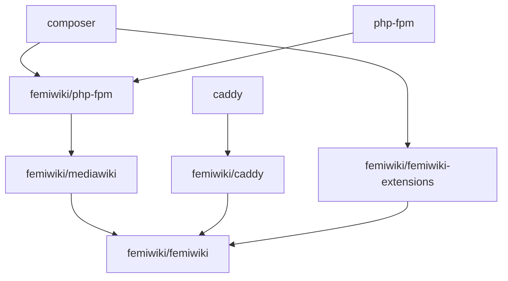

# FemiWiki MediaWiki server

[![Container Registry]][container registry link]
[![Github checks Status]][github checks link]

> [!IMPORTANT]  
> This docker image is specifically designed for the needs of FemiWiki, contains
> FemiWiki-specific configurations and includes arbitrary MediaWiki extensions.
> It is not recommended to use this image for general purposes. We recommend
> using the
> [Docker official image for MediaWiki](https://hub.docker.com/_/mediawiki/).

The MediaWiki Docker images used by [femiwiki.com], a Korean feminist wiki. This
repository holds the Dockerfiles, a Compose file for testing, and related code.

## Usage of Docker Image

The image is a [PHP-FPM] server for FemiWiki, and the same image can also run a
[Caddy] web server. See the example Compose file below. compose.yaml has a
complete, runnable example for development.

```yml
fastcgi:
  image: ghcr.io/femiwiki/femiwiki
http:
  image: ghcr.io/femiwiki/femiwiki
  command: caddy run
  ports:
    - 80:80
  volumes:
    - ./path/to/Caddyfile:/srv/femiwiki.com/Caddyfile:ro
```

### MediaWiki

The following environment variables are available.

- `MEDIAWIKI_SERVER`: Overrides `$wgServer`. Defaults to
  `'https://femiwiki.com'`.
- `MEDIAWIKI_DEBUG_MODE`: If set, turns on MediaWiki's debugging features and
  disables extensions that are hard to set up in a development environment.
- `MEDIAWIKI_SKIP_INSTALL`: If set, install.php is not run when the container
  starts. install.php checks whether the database is set up, initializes it if
  not, and generates LocalSettings.php, so it can be skipped once both are done.
- `MEDIAWIKI_SKIP_UPDATE`: If set, update.php is not run when the container
  starts. update.php is only needed right after installing MediaWiki or after
  adding an extension.
- `MEDIAWIKI_SKIP_IMPORT_SITES`: If set, importSites.php is not run when the
  container starts. Unless its input has changed, it never needs to run more
  than once against the same database.

LocalSettings.php and site-list.xml in `/etc/mediawiki` can be replaced for
testing.

### Caddy

To run Caddy, mount a Caddyfile at `/srv/femiwiki.com/Caddyfile` and use
`caddy run` as the command. See [Usage of Docker Image](#usage-of-docker-image).
Note that with a file mount, edits made by some text editors may not be picked
up (<https://github.com/moby/moby/issues/15793>).

```text
./caddy/Caddyfile.dev:/srv/femiwiki.com/Caddyfile:ro
```

## Usage of Docker Compose file

You can run FemiWiki locally with [Docker Swarm] or [Docker Compose] as shown
below. This starts the services MediaWiki needs, such as a database and
memcached.

```bash
docker swarm init

cp dockers/femiwiki/LocalSettings.php development/
cp dockers/femiwiki/Hotfix.php development/

# In case of Docker swarm
docker stack deploy --prune -c compose.yaml mediawiki
# If you want some tweaks
docker stack deploy --prune -c compose.yaml -c compose.override.yaml mediawiki
# In case of Docker Compose
docker compose -f compose.yaml up
```

Then visit [http://127.0.0.1:8080] in your browser.

## Build

These commands are useful when developing FemiWiki.

```bash
# Build the Docker image
docker build -t femiwiki/mediawiki:dev .
# Run the modified image
docker service update --force femiwiki_fastcgi

# Check configs/LocalSettings.php
composer install
composer test
# Fix configs/LocalSettings.php automatically
composer fix
```



&nbsp;

---

The source code of _femiwiki/mediawiki_ is primarily distributed under the terms
of the [GNU Affero General Public License v3.0] or any later version. See
[COPYRIGHT] for details.

[container registry]: https://badgen.net/badge/icon/docker?icon=docker&label
[container registry link]: https://github.com/orgs/femiwiki/packages/container/mediawiki
[github checks status]: https://badgen.net/github/checks/femiwiki/docker-mediawiki
[github checks link]: https://github.com/femiwiki/docker-mediawiki
[femiwiki.com]: https://femiwiki.com
[docker swarm]: https://docs.docker.com/engine/swarm/
[docker compose]: https://docs.docker.com/compose/
[php-fpm]: https://php-fpm.org/
[caddy]: https://caddyserver.com/
[http://127.0.0.1:8080]: http://127.0.0.1:8080
[gnu affero general public license v3.0]: LICENSE
[copyright]: COPYRIGHT
